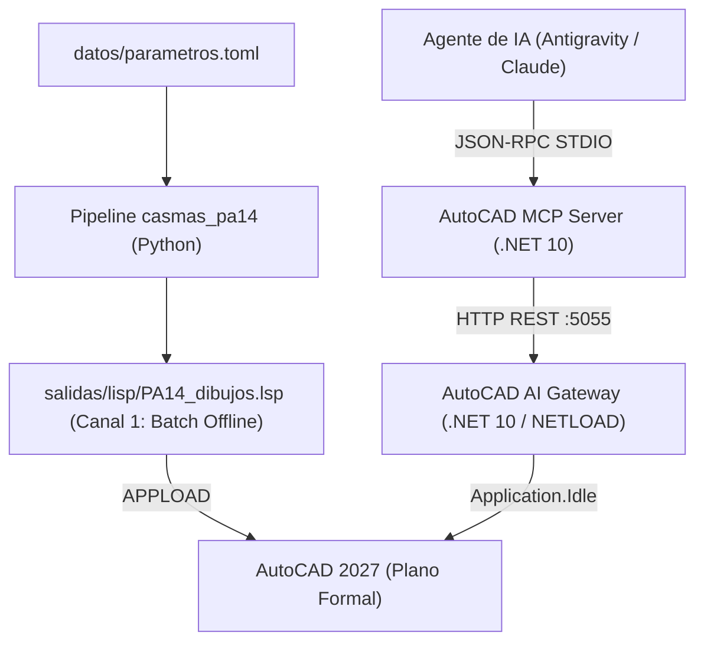

<div align="center">


 <h1>Túnel Casmas Huaraz PA14 </h1>


[](https://www.python.org/downloads/release/python-311/)
[](https://opensource.org/licenses/MIT)
[](https://github.com/astral-sh/uv)
[](https://qgis.org/)
[]()
[](https://www.unitru.edu.pe/)

</div>

Proyecto del curso de **Túneles**: cálculos de ingeniería del túnel y sus
instalaciones, exportados a **Excel** (un libro por entregable), memorias técnicas
en **Markdown** y doble canal de planos para **AutoCAD** (generación batch en **AutoLISP** e interacción en tiempo real vía **AutoCAD AI Gateway** y **MCP Server**).

---

## 1. Entregables de Ingeniería

| # | Excel | Hojas / Contenido | Memoria | Estado |
|---|-------|-------------------|---------|--------|
| **01** | `01_Ubicacion.xlsx` | Coordenadas · Eje del túnel · Distancias | — | ✅ |
| **02** | `02_Geologia.xlsx` | Perfil litológico · RMR · Calidad de roca | — | ⏳ datos estructurados |
| **11** | `11_Portales.xlsx` | Banquetas_Portales (Geometría, taludes, volúmenes in-situ y esponjados) | — | ✅ |
| **15** | `15_Voladura_Banquetas.xlsx` | Voladura de banquetas en superficie (Epiroc PowerROC T25 — Modelo Konya): Calculadora_Konya_T25 · Voladura_Por_Banqueta · Ficha_PowerROC_T25 · BD_Explosivos · BD_Rocas · BD_Brocas_Equipos · Criterios_y_Fuentes | `15_voladura_banquetas.md` | ✅ |
| **03** | `03_Seccion.xlsx` | Geometría · Perforación y avance · Volúmenes | `03_seccion.md` | ✅ |
| **14** | `14_Afrontonamiento.xlsx` | Afrontonamiento y sellado del portal: RMR_Geomecanica · Teoria_Cargas_Terzaghi · Afrontonamiento_Portal · Malla_Electrosoldada · Pernos_RockBolt · Shotcrete_Robotizado | `14_afrontonamiento.md` | ✅ |
| **12** | `12_Voladura.xlsx` | Voladura subterránea del túnel (Jumbo 3 brazos Sandvik DT1131): Malla_y_Avance_Tunel · Voladura_Konya_Tunel · Ficha_Jumbo_DT1131 · BD_Explosivos · Catalogo_Detonacion · BD_Rocas · BD_Brocas_Equipos | `12_voladura.md` | ✅ |
| **04** | `04_Personal.xlsx` | Relación de personal · Turnos · Resumen | `04_personal.md` | ✅ |
| **05** | `05_Campamento.xlsx` | Edificaciones · Áreas requeridas · Resumen | `05_campamento.md` | ✅ |
| **06** | `06_Maquinaria.xlsx` | Frente · Botadero · Campamento · 26 Fichas técnicas individuales · Resumen_Flota | `06_maquinaria.md` | ✅ |
| **07** | `07_Polvorin.xlsx` | Consumo explosivos · Distancias de seguridad · Dimensionamiento | — | ✅ |
| **08** | `08_Agua.xlsx` | Consumo industrial/humano · PETAP · PETAR · Pozos | — | ✅ |
| **09** | `09_Electricidad.xlsx` | Ventilación · Subestaciones y cargas · Grupo electrógeno · Resumen | — | ✅ |
| **10** | `10_Cronograma.xlsx` | Actividades constructivas · Duraciones · Carta Gantt | — | ✅ |
| **13** | `13_Sostenimiento.xlsx` | Sostenimiento subterráneo interior del túnel (Bieniawski/Barton: pernos, shotcrete y cerchas por tramo) | `13_sostenimiento.md` | ✅ |
| **—** | `PA14_dibujos.lsp` | Planos AutoLISP: Sección tipo, campamento, polvorines, saneamiento, botadero, malla | — | ✅ |
| **—** | `PA14_DG2018_MTC_Roadway_Design_Standards.xml` | Criterios de diseño geométrico vial DG-2018 (MTC Perú) para Autodesk Civil 3D | [`civil3d/README.md`](civil3d/README.md) | ✅ |

Cada hoja utiliza el formato estándar: **Descripción | Símbolo | Valor | Unidad | Fórmula / Fuente**.  
Los cálculos se formulan de manera dinámica en Excel (`={Simbolo1}*{Simbolo2}`), garantizando recálculo inmediato sin valores estáticos hardcodeados.

---

## 2. Integración con AutoCAD: Doble Canal

El proyecto cuenta con dos canales independientes y complementarios para generar planos y visualizar geometrías en AutoCAD:



### Canal 1: Batch Portable (AutoLISP)
* **Archivo generado:** `salidas/lisp/PA14_dibujos.lsp`.
* **Propósito:** Entregable formal y autónomo para entrega del proyecto. No requiere tener AutoCAD abierto durante la ejecución de Python.
* **Carga en AutoCAD:** Comando `APPLOAD` → seleccionar `PA14_dibujos.lsp`.
* **Comandos disponibles:** `PA14_TODO`, `PA14_SECCION`, `PA14_CAMPAMENTO`, `PA14_POLVORIN`, `PA14_SANEAMIENTO`, `PA14_BOTADERO`, `PA14_MALLA`.
* **Estándar:** Unidades en metros, capas institucionales `PA14-*`, entidades generadas mediante `entmake`.

### Canal 2: Interactivo en Tiempo Real (Gateway + MCP Server en C# / .NET 10)
* **Propósito:** Control directo, dibujo interactivo y telemetría de AutoCAD por parte de asistentes de Inteligencia Artificial (Antigravity, Cursor, Claude Desktop).
* **Puerto oficial:** **`http://localhost:5055/`**.
* **Componentes (`plugins/`):**
  1. **`AutoCAD_AI_Gateway`**: Plugin nativo .NET 10 cargado en AutoCAD con `NETLOAD`. Expone comandos `AI_START_SERVER` y `AI_STOP_SERVER`, gestionando una cola concurrente segura en `Application.Idle` con cancelación preventiva `\x03\x03` y 16 endpoints REST (8 de AutoCAD base y 8 de Civil 3D: superficies, cotas de terreno y alineamientos, con lectura y escritura; el mismo DLL funciona en AutoCAD 2027 y Civil 3D 2027).
  2. **`AutoCAD_MCP_Server`**: Servidor Model Context Protocol v2.2 (STDIO) que expone 20 herramientas de IA (12 de AutoCAD y 8 de Civil 3D) para consultar el modelo (capas, textos, entidades, límites) e inyectar comandos CAD paramétricos o YQArch en metros.

### Criterios de Diseño Vial Civil 3D (DG-2018 MTC Perú)
* **Carpeta dedicada:** [`civil3d/`](civil3d/README.md).
* **Fuente de datos:** [`civil3d/dg2018_datos.toml`](civil3d/dg2018_datos.toml), verificada contra [`docs/entradas/manual_de_carreteras_dg_2018.pdf`](docs/entradas/manual_de_carreteras_dg_2018.pdf) ([PDF DG-2018 MTC en Google Drive](https://drive.google.com/file/d/1kdXJQ1sfLHBTbPC3mbCcYBWaTW8UOO0C/view?usp=sharing)).
* **Archivo generado:** `civil3d/PA14_DG2018_MTC_Roadway_Design_Standards.xml` mediante `uv run python civil3d/generar_dg2018.py`.

---

## 3. Requisitos del Sistema

* **Cálculos y Python:** [uv](https://docs.astral.sh/uv/) (administra automáticamente Python 3.12 y el entorno virtual `.venv`).
* **CAD Plugins (Opcional, para desarrollo en C#):**
  * SDK de .NET 10.0 (x64).
  * Autodesk AutoCAD 2027 (x64).

---

## 4. Uso Rápido y Automatización

### Configuración inicial del entorno Python:
```powershell
uv sync                 # Crea .venv e instala dependencias
uv run pa14             # Ejecuta los 13 módulos y genera Excel + LISP
```

### Scripts de automatización en `scripts/`:

| Acción | Comando PowerShell (Windows) | Descripción |
|---|---|---|
| **Verificación Total** | `.\scripts\check.ps1` | Ruff format + Ruff check + XML Civil 3D + Pytest + Generación PA14 |
| **Verificación Rápida** | `.\scripts\check.ps1 -Fast` | Linting + XML Civil 3D + Arnés de código fuente en memoria (~1.5 s) |
| **Monitor Reactivo (Arnés en Vivo)** | `.\scripts\watch_harness.ps1` | Vigila `src/`, `datos/` y `civil3d/`; ejecuta el arnés ante cada guardado |
| **Generar Entregables** | `.\scripts\run.ps1` | Ejecuta el pipeline completo de ingeniería |
| **Compilar Plugins CAD** | `.\scripts\build_plugins.ps1` | Compila `AutoCAD_AI_Gateway` y `AutoCAD_MCP_Server` en Release |

---

## 5. Tareas de Desarrollo y Pruebas

| Tarea | Comando |
|---|---|
| Actualizar dependencias | `uv sync` |
| Ejecutar pipeline de ingeniería | `uv run pa14` |
| Generar criterios viales Civil 3D (DG-2018 `.xml`) | `uv run python civil3d/generar_dg2018.py` |
| Formatear código Python | `uv run ruff format .` |
| Linting y correcciones automáticas | `uv run ruff check --fix .` |
| Ejecutar suite de pruebas (incluye guardián documental) | `uv run pytest -q` |
| Compilar solución .NET de AutoCAD | `dotnet build -c Release plugins/AutoCAD_Integration.slnx` |
| Sincronizar grafo de conocimiento (Graphify) | `uvx --from graphifyy graphify update .` |

---

## 6. Estructura del Repositorio

```
├── datos/
│   └── parametros.toml          # ÚNICA fuente de datos de entrada del proyecto
├── civil3d/
│   ├── README.md                # Documentación y guía de criterios DG-2018 en Civil 3D
│   ├── dg2018_datos.toml        # Parámetros normativos DG-2018 MTC (Tabla 302.02, Fig. 304.07)
│   ├── generar_dg2018.py        # Generador y validador del XML de criterios para Civil 3D
│   └── PA14_DG2018_MTC_Roadway_Design_Standards.xml # Estándares viales para Civil 3D
├── src/casmas_pa14/
│   ├── main.py                  # Orquestador del pipeline (MODULOS 01-13)
│   ├── config.py                # Rutas y carga del archivo TOML
│   ├── modelo.py                # Estructuras Libro, Hoja, Tabla
│   ├── excel.py                 # Motor de generación dinámica de Excel
│   ├── lisp.py                  # Generador de planos AutoLISP (.lsp)
│   ├── memoria.py               # Generador de memorias técnicas (.md)
│   └── modulos/                 # 13 módulos de ingeniería (m01 a m13)
├── plugins/
│   ├── AutoCAD_Integration.slnx # Solución unificada de integración CAD (.NET 10)
│   ├── AutoCAD_AI_Gateway/      # Plugin nativo C# para AutoCAD 2027 (puerto 5055)
│   └── AutoCAD_MCP_Server/      # Servidor Model Context Protocol v2.2 STDIO
├── tests/                       # Suite de pruebas unitarias y guardián documental
├── docs/
│   ├── memoria/                 # Memorias técnicas de cálculo en Markdown
│   ├── entradas/                # Documentos de referencia y especificaciones
│   └── PLANIFICACION.md         # Seguimiento de avance del proyecto
├── salidas/                     # Entregables generados (ignorado por git)
│   ├── excel/                   # Libros de cálculo .xlsx
│   ├── lisp/                    # Archivo PA14_dibujos.lsp
│   └── documentos/              # Reportes y salidas documentales
├── scripts/                     # Scripts de automatización (check, run, build_plugins)
├── AGENTS.md                    # Reglas obligatorias para asistentes de IA
└── pyproject.toml               # Configuración del proyecto, dependencias y herramientas
```

---

## 7. Normas de Referencia

* **DS 024-2016-EM**: Reglamento de Seguridad y Salud Ocupacional en Minería (ventilación, refugios, polvorines, distancias).
* **Reglamento Nacional de Edificaciones (RNE)**: Normas OS.100, IS.010, IS.020 (saneamiento, agua potable y alcantarillado).
* **Reglamento SUCAMEC**: Normativa técnica para almacenamiento de explosivos y polvorines auxiliares.
* **Manual de Carreteras: Diseño Geométrico DG-2018 (MTC Perú)**: Criterios de visibilidad (Tablas 205.01 y 205.03), radios mínimos (Tabla 302.02), transición de peralte (Art. 302.08), sobreancho (Art. 302.09.03), curvas verticales (Art. 303.04) y banquetas (Figura 304.07) — [`docs/entradas/manual_de_carreteras_dg_2018.pdf`](docs/entradas/manual_de_carreteras_dg_2018.pdf) ([PDF en Google Drive](https://drive.google.com/file/d/1kdXJQ1sfLHBTbPC3mbCcYBWaTW8UOO0C/view?usp=sharing)).
* **Manual de Carreteras: Túneles, Muros y Obras Complementarias MC-03-16 (MTC Perú)**: Criterios de diseño de túneles viales y obras conexas ([PDF en Google Drive](https://drive.google.com/file/d/1IIdtiAq3M-wXH4l8uuyQueE2mOMJV9Xr/view?usp=drive_link)).
* **Geomecánica de Túneles**: Criterios de Hoek-Brown, Bieniawski (RMR) y Barton (Q) para sostenimiento; formulación de C. Konya para voladura.
