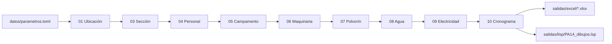

# Túnel Casmas Huaraz PA14

Proyecto del curso de **Túneles**: cálculos de ingeniería del túnel y sus
instalaciones, exportados a **Excel** (un libro por entregable) y a
**AutoLISP** (`.lsp`) para dibujar los planos base en AutoCAD.

## Entregables

| # | Excel | Hojas | Estado |
|---|-------|-------|--------|
| 01 | `01_Ubicacion.xlsx` | Coordenadas · Eje del tunel · Distancias | ✅ |
| 02 | `02_Geologia.xlsx` | — | ⏳ pendiente de datos |
| 03 | `03_Seccion.xlsx` | Geometria · Perforacion y avance · Volumenes | ✅ |
| 04 | `04_Personal.xlsx` | Relacion de personal · Resumen | ✅ |
| 05 | `05_Campamento.xlsx` | Edificaciones · Resumen | ✅ |
| 06 | `06_Maquinaria.xlsx` | Frente · Botadero · Campamento · 26 Fichas técnicas individuales · Resumen_Flota | ✅ |
| 07 | `07_Polvorin.xlsx` | Consumo · Dimensiones | ✅ |
| 08 | `08_Agua.xlsx` | Consumo · PETAP · PETAR · Pozo | ✅ |
| 09 | `09_Electricidad.xlsx` | Ventilacion · Cargas · Resumen | ✅ |
| 10 | `10_Cronograma.xlsx` | Actividades · Gantt | ✅ |
| — | `PA14_dibujos.lsp` | Sección, campamento, polvorines, PETAP/PETAR, botadero | ✅ |

Cada hoja usa el mismo formato: **Descripción | Símbolo | Valor | Unidad | Fórmula / Fuente**.
Un dato se calcula en un solo libro; los demás lo referencian (sin repeticiones).

## Requisitos

- [uv](https://docs.astral.sh/uv/) (gestiona Python 3.12 y el entorno virtual `.venv`).
- No se necesita Python instalado en el sistema: **todo se ejecuta con `uv run`**.

## Uso rápido

```powershell
uv sync                 # crea .venv e instala dependencias (una sola vez)
uv run pa14             # genera salidas/excel/*.xlsx y salidas/lisp/PA14_dibujos.lsp
```

Opciones: `uv run pa14 --parametros otro.toml --salida otra_carpeta`.

## Tareas de desarrollo

| Tarea | Comando |
|-------|---------|
| Instalar / actualizar entorno | `uv sync` |
| Generar entregables | `uv run pa14` |
| Formatear código | `uv run ruff format .` |
| Revisar código (lint) | `uv run ruff check --fix .` |
| Pruebas | `uv run pytest -q` |
| Agregar librería | `uv add <paquete>` |
| Todo antes de un commit | `uv run ruff format . ; uv run ruff check . ; uv run pytest -q` |

## Flujo de trabajo



1. Editar **solo** `datos/parametros.toml` (los valores con `(S)` son supuestos a reemplazar).
2. Ejecutar `uv run pa14`.
3. Revisar los Excel y la consola (avisa si alguna distancia mínima no cumple).

## Dibujar en AutoCAD

1. `APPLOAD` → cargar `salidas/lisp/PA14_dibujos.lsp`.
2. Escribir `PA14_TODO` (todo) o un comando individual:
   `PA14_SECCION`, `PA14_CAMPAMENTO`, `PA14_POLVORIN`, `PA14_SANEAMIENTO`, `PA14_BOTADERO`.
3. Indicar el punto de inserción. Unidades: metros. Capas `PA14-*` se crean solas.

## Estructura

```
├── datos/parametros.toml        # ÚNICA fuente de datos de entrada
├── src/casmas_pa14/
│   ├── main.py                  # orquestador (comando `pa14`)
│   ├── config.py                # rutas y lectura del TOML
│   ├── modelo.py                # Libro / Hoja / Tabla
│   ├── excel.py                 # formato de los Excel
│   ├── lisp.py                  # generador AutoLISP
│   └── modulos/m01…m10_*.py     # un módulo por entregable
├── tests/                       # pruebas (pytest)
├── docs/PLANIFICACION.md        # control de tareas del proyecto
├── salidas/                     # generado (ignorado por git)
├── AGENTS.md                    # reglas para asistentes de IA
└── pyproject.toml               # dependencias + Ruff + pytest
```

## Normas de referencia

DS 024-2016-EM (Seguridad y Salud Ocupacional en Minería) · RNE OS.100, IS.010, IS.020 ·
Reglamento SUCAMEC (explosivos). Verificar cada valor `(S)` con la norma o el docente.
