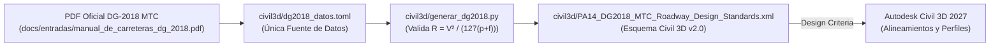

# Criterios de Diseño Vial DG-2018 (MTC Perú) para Autodesk Civil 3D

Esta carpeta (`civil3d/`) contiene la parametrización normativa y el generador automatizado en Python del archivo de criterios de diseño geométrico vial **DG-2018 (MTC Perú)** para **Autodesk Civil 3D**, aislado dentro del proyecto sin modificar ninguna carpeta global de instalación de Autodesk.

> **Fuente documental oficial:** Todos los parámetros y fórmulas del generador han sido verificados directamente contra el **Manual de Carreteras: Diseño Geométrico DG-2018 (MTC Perú)**:
> - ⚡ **Índice Rápido de Líneas (Consulta instantánea sin gastar tokens):** [`docs/entradas/indice_dg2018.md`](../docs/entradas/indice_dg2018.md)
> - 📄 **Versión en Markdown (convertida con MarkItDown para lectura directa):** [`docs/entradas/manual_de_carreteras_dg_2018.md`](../docs/entradas/manual_de_carreteras_dg_2018.md)
> - 📁 **Copia local en PDF:** [`docs/entradas/manual_de_carreteras_dg_2018.pdf`](../docs/entradas/manual_de_carreteras_dg_2018.pdf)
> - 🌐 **Enlace en Google Drive (DG-2018 Carreteras):** [Manual de Carreteras: Diseño Geométrico DG-2018 (PDF)](https://drive.google.com/file/d/1kdXJQ1sfLHBTbPC3mbCcYBWaTW8UOO0C/view?usp=sharing)
> - 🚇 **Enlace complementario en Google Drive (MC-03-16 Túneles):** [Manual de Carreteras: Túneles, Muros y Obras Complementarias (PDF)](https://drive.google.com/file/d/1IIdtiAq3M-wXH4l8uuyQueE2mOMJV9Xr/view?usp=drive_link)

---

## 1. Arquitectura y Flujo de Generación



| Archivo | Propósito |
|---|---|
| [`dg2018_datos.toml`](./dg2018_datos.toml) | Única fuente de datos normativos verificados con el PDF oficial del DG-2018 (Tablas 205.01, 205.03, 302.02, 302.13–302.18, 304.01, 304.03, Art. 302.08, 302.09.03, 303.04 y Figura 304.07). |
| [`generar_dg2018.py`](./generar_dg2018.py) | Script en Python que valida matemáticamente los radios mínimos con la fórmula $R = \frac{V^2}{127(p + f)}$ y compila el archivo `.xml` bajo el esquema `urn:Civil3DRoadwayDesignStandards-schema`. |
| [`PA14_DG2018_MTC_Roadway_Design_Standards.xml`](./PA14_DG2018_MTC_Roadway_Design_Standards.xml) | Archivo XML generado listo para cargarse en los alineamientos y perfiles de Autodesk Civil 3D. |
| [`guia_uso_dg2018.md`](./guia_uso_dg2018.md) | Guía rápida resumida de referencia operativa. |

---

## 2. Comando para Generar el Archivo `.xml`

Para regenerar el archivo `PA14_DG2018_MTC_Roadway_Design_Standards.xml` tras cualquier ajuste en `dg2018_datos.toml`, ejecuta desde la raíz del proyecto:

```powershell
uv run python civil3d/generar_dg2018.py
```

Para ejecutar las pruebas unitarias que validan la fórmula de radios mínimos, los parámetros $K$ de curvas verticales, la estructura del esquema XML y la vinculación entre tablas de radio y peralte:

```powershell
uv run pytest tests/test_civil3d_dg2018.py -q
```

---

## 3. Cómo Cargar el `.xml` en Autodesk Civil 3D

1. En Civil 3D, abre la creación o propiedades del alineamiento (*Create Alignment – Layout* o *Alignment Properties*) y dirígete a la pestaña **Design Criteria**.
2. Activa las casillas **Use criteria-based design** y **Use design criteria file**.
3. Haz clic en el botón `...` y selecciona el archivo local de este repositorio:
   ```text
   civil3d/PA14_DG2018_MTC_Roadway_Design_Standards.xml
   ```
4. En **Minimum Radius Table**, elige la tabla correspondiente a la ubicación y orografía de la vía:
   - `DG-2018 MTC eMax 4% - Area urbana`
   - `DG-2018 MTC eMax 6% - Rural con peligro de hielo`
   - `DG-2018 MTC eMax 8% - Rural plano u ondulado`
   - `DG-2018 MTC eMax 12% - Rural accidentado o escarpado`
5. En **Transition Length Table** (peraltes), selecciona `2 Lane` (giro en el eje, $B = 3.60\text{ m}$) o `4 Lane` ($B = 7.20\text{ m}$) y en **Attainment Method** elige:
   - `DG-2018 MTC Bombeo (Crowned Roadway)`
6. Para **Offset Alignments (Sobreancho Automático en Curvas)**:
   - Ve a **Alignment → Create Offset Alignment** → pestaña **Widening Criteria**.
   - Activa **Add widening around curves** y **Use criteria-based design**.
   - En **Widening Method**, selecciona la tabla o fórmula preconfigurada para tu vehículo de diseño (Tabla 202.01 DG-2018):
     - `DG-2018 MTC Tabla Sobreancho: Omnibus 2 ejes B2 / Camion 2 ejes C2 (L=8.25m)` *(Recomendado: aplica umbral $S_a \ge 0.40\text{ m}$ automáticamente)*
     - `DG-2018 MTC Tabla Sobreancho: Omnibus 3 ejes B3-1 / Camion 3 ejes C3 (L=9.95m)`
     - `DG-2018 MTC Tabla Sobreancho: Omnibus 2 ejes B2 con vuelo delantero (L=10.55m)`
     - `DG-2018 MTC Tabla Sobreancho: Semirremolque articulado T2S1 / T3S2 (L=12.50m)`
     - *(También disponibles como `DG-2018 MTC Formula Sobreancho: ...` con $L$ fijo integrado)*
   - En **Apply Widening To**, elige **`Inside Only`** (Borde interior de la curva, según Art. 302.09.03 DG-2018) y en **Normal Lane Width** selecciona `7.2m` (o `6.6m` / `6.0m`).
7. Para perfiles longitudinales (*Create Profile – Layout* → **Design Criteria**), la tabla oficial disponible es:
   - `DG-2018 MTC Curvas Verticales (Art. 303.04)`

---

## 4. Trazabilidad Normativa Verificada contra el PDF `DG-2018`

| Componente en el XML / TOML | Estado | Referencia Exacta en el PDF `DG-2018` |
|---|---|---|
| **Radios mínimos ($R_{\min}$)** | ✅ **Oficial** | **Tabla 302.02 (pág. 129):** 4 tablas para $p_{\max} \in \{4\%, 6\%, 8\%, 12\%\}$, velocidades de $30\text{ a }130\text{ km/h}$, verificados con $R = \frac{V^2}{127(p+f)}$. |
| **Distancia de visibilidad de parada ($D_p$)** | ✅ **Oficial** | **Tabla 205.01 (pág. 104):** Valores redondeados de $35\text{ a }285\text{ m}$ para $30\text{–}130\text{ km/h}$ ($t_p = 2.5\text{ s}, a = 3.4\text{ m/s}^2, h_1 = 1.07\text{ m}, h_2 = 0.15\text{ m}$). |
| **Distancia de visibilidad de paso ($D_a$)** | ✅ **Oficial** | **Tabla 205.03 (pág. 109):** Valores redondeados de $200\text{ a }815\text{ m}$ para $30\text{–}130\text{ km/h}$ ($h_1 = 1.07\text{ m}, h_2 = 1.30\text{ m}$). |
| **Parámetro $K$ en curvas verticales** | ✅ **Oficial** | **Art. 303.04.03 y 303.04.04 (págs. 178–182, Figuras 303.06–303.08, Tablas 303.02–303.03):**<br>• Convexa parada: $K_{\text{SSD}} = \frac{D_p^2}{404}$<br>• Convexa adelantamiento: $K_{\text{PSD}} = \frac{D_a^2}{946}$<br>• Cóncava (faros): $K_{\text{HSD}} = \frac{D_p^2}{120 + 3.5 D_p}$ |
| **Sobreancho en curvas ($S_a$) y Vehículos** | ✅ **Oficial** | **Art. 302.09.03, Figura 302.18B (pág. 161), Tabla 302.20 (pág. 162) y Tabla 202.01 (pág. 27):** $S_a = n(R - \sqrt{R^2 - L^2}) + \frac{V}{10\sqrt{R}}$, con $S_{a,\min} = 0.40\text{ m}$, precalculado en tablas y fórmulas por vehículo (`B2/C2`, `B3-1/C3`, `T2S1/T3S2`). |
| **Transición de peralte ($L_t$ e $i_{p,\max}$)** | ✅ **Oficial** | **Art. 302.08 (pág. 152) y Tablas 302.13–302.18 (págs. 152–155):** $i_{p,\max} = 1.8 - 0.01V$ (%) y $L_{\min} = \frac{p_f - p_i}{i_{p,\max}} B$, con $B = 3.60\text{ m}$ (carril estándar, **Tabla 304.01**, pág. 191) y bombeo $2.0\%$ (**Tabla 304.03**, pág. 195). |
| **Banquetas de corte y terraplén** | ✅ **Oficial** | **Figura 304.07 (pág. 203):** Parametrizada en `[banquetas]` de `dg2018_datos.toml` para modelado en el *Assembly* (`DaylightBench`). |
| **Discretización intermedia $e(R)$** | ℹ️ **Ábacos Fig. 302.02–302.05 `(S)`** | El manual publica las relaciones $e(R, V)$ como ábacos gráficos (**Figuras 302.02 a 302.05**, págs. 130–131); el generador discretiza los escalones cada $0.5\%$ con variación lineal en $1/R$ ($e = p_{\max} \cdot R_{\min}/R$). |

> **Nota sobre la Tabla 302.02 ($p_{\max} = 6\%$, $V = 80\text{ km/h}$, pág. 129):** El manual imprime $R_{\text{calc}} = 252.9\text{ m}$ mientras que la evaluación exacta de la fórmula arroja $252.0\text{ m}$ (diferencia de $0.9\text{ m}$). Se conserva el valor oficial impreso y su redondeo normativo ($255\text{ m}$).

---

## 5. Parámetros de Banquetas — Figura 304.07 (Para *Subassembly* en Civil 3D)

El esquema XML de criterios de alineamiento de Civil 3D no gobierna taludes de corte/relleno ni banquetas; estos se aplican en la sección transversal (*Assembly* mediante `DaylightBench` o *Subassembly Composer*) usando los valores oficiales de la **Figura 304.07 (pág. 203)** registrados en `[banquetas]` de [`dg2018_datos.toml`](./dg2018_datos.toml):

| Parámetro | Valor Normativo (Figura 304.07, pág. 203) |
|---|---|
| Altura de corte que exige banqueta | $> 7.00\text{ m}$ |
| Separación vertical entre banquetas sucesivas | $10.00\text{ m}$ |
| Ancho de banqueta en corte | $3.00\text{ m}$ (pendiente transversal $2\%$) |
| Pendiente longitudinal máxima de banqueta | $3\%$ (o la del camino si es menor) |
| Banqueta en ladera ($P \ge 20\%$) | Ancho mín. $3.00\text{ m}$, pendiente $4\%$, talud $3:1\text{ (V:H)}$ |
| Escalonamiento de cambio de talud en relleno | Escalón $V = 1.00\text{ m}$, $H = 1.50\text{ m}$ |
| Tratamiento superficial de banquetas | Sembradas en todo su ancho, con senderos de acceso para mantenimiento liviano |
