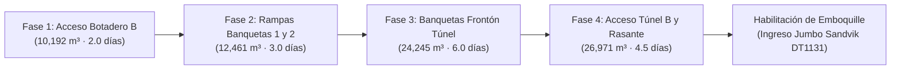

# Memoria Técnica 21: Control y Cálculo de Tiempos Tramo a Tramo por Progresiva, Tren de Maquinaria y Limpieza de Cunetas

**Proyecto:** Túnel Casmas - Huaraz PA14  
**Asignatura:** Curso de Túneles e Ingeniería Subterránea  
**Fuentes de Datos:** Autodesk Civil 3D 2026, Caterpillar Performance Handbook Ed. 49, `calculo_carguio_acarreo_tunel.xlsx` (Unidad 2)  
**Equipos Principales:** Cargador Frontal CAT 966H, 4 Camiones Volquetes Volvo FMX 8x4, Perforadora Epiroc PowerROC T25, Excavadora CAT 336D, Motoniveladora CAT 140K  
**Entregables Vinculados:** `11_Portales.xlsx` (Hoja `Control_Tiempos_Progresivas`), `06_Maquinaria.xlsx`, `10_Cronograma.xlsx`  
**Fecha:** Octubre 2026  

---

## 1. Alcance y Objetivos Técnicos

La presente memoria técnica establece el **cálculo y control determinista del tiempo de ejecución tramo a tramo por progresiva ($0+000-0+020$, $0+020-0+040$, etc.)** para los 5 alineamientos de la infraestructura exterior del Túnel Casmas - Huaraz PA14 (Portal B / Huaraz):
1. **Acceso al Túnel B** (`ACCESO-TUNEL-B`, 200 m).
2. **Acceso al Botadero B** (`ALINEAMIENTO-BOTADERO-PORTAL-B`, 356 m).
3. **Acceso a Banqueta 1** (`ALINEAMIENTO-ACCESO-BANQUETA-1`, 276 m).
4. **Acceso a Banqueta 2** (`ALINEAMIENTO-ACCESO-BANQUETA-2`, 107 m).
5. **Banquetas del Túnel y Frontón en sí mismas** (`BANQUETAS-TUNEL`, 40 m).

El modelado cinemático garantiza que cada tramo de 20 metros cuente con:
* Volúmenes exactos de corte en banco y material suelto transportado.
* Número real de viajes de volquete de $16\text{ m}^3$.
* Tiempo de ciclo variable en función de la distancia al Botadero B ($T_{ciclo}(D_i)$).
* Tiempo de excavación, perfilado y limpieza de cunetas triangulares de drenaje.
* Duración efectiva en horas, guardias de trabajo ($10.5\text{ h/guardia}$) y días calendario.

---

## 2. Especificaciones y Rendimientos del Tren de Maquinaria

### 2.1. Cargador Frontal Caterpillar 966H (Unidad de Carguío en Pila)
* **Motor:** Cat C11 ACERT de **260 HP**.
* **Capacidad de Cuchara:** $4.00\text{ m}^3$ en banco / $5.06\text{ m}^3$ colmado con factor de llenado $k = 0.95$.
* **Ciclo Elemental por Pasada ($t_e$):**
  * Llenado y penetración en pila de roca volada: $10.00\text{ s}$
  * Retroceso e ida cargado: $8.06\text{ s}$
  * Volteo y descarga sobre tolva: $2.70\text{ s}$
  * Retorno vacío y posicionamiento: $10.80\text{ s}$
  * **Total por pasada:** $t_e = 31.56\text{ s} = \mathbf{0.526\text{ min}}$
* **Pases por Camión Volvo FMX (16 m³ suelto):**
  $$N_p = \frac{16.00}{5.06 \cdot 0.95} = 3.33 \implies \mathbf{4\text{ pasadas}}$$
* **Tiempo Total de Carguío por Camión ($T_{carguio}$):**
  $$T_{carguio} = 4 \times 0.526\text{ min} = \mathbf{2.104\text{ min}}$$

---

### 2.2. Camión Volquete Volvo FMX 8x4 Rígido (Flota de Acarreo de 4 Unidades)
* **Motor:** D13A de **500 HP** con caja I-Shift para minería pesada.
* **Tolva Roquera:** Capacidad útil de **$16.00\text{ m}^3$ suelto** (**$32.0\text{ t}$** carga útil).
* **Velocidades Operativas:** $V_{cargado} = 25.0\text{ km/h} = 416.67\text{ m/min}$, $V_{vacio} = 35.0\text{ km/h} = 583.33\text{ m/min}$.
* **Tiempos Fijos:** Descarga en botadero ($0.70\text{ min}$) + Maniobras ($0.40\text{ min}$) = **$1.10\text{ min}$**.
* **Fórmula del Tiempo de Ciclo Total según Distancia al Botadero ($D_i$ en metros):**
  $$T_{ciclo, i} = 2.104 + \frac{D_i}{416.67} + \frac{D_i}{583.33} + 1.100 = \mathbf{3.204 + 0.004114 \cdot D_i \quad (\text{min})}$$

---

### 2.3. Perforación y Limpieza/Perfilado de Cunetas
* **Perforadora sobre Orugas Epiroc PowerROC T25:** Rendimiento neto de **$35.0\text{ m/h}$** en roca andesítica para perforación de mallas de precorte y producción en bancos de 6 m.
* **Excavadora CAT 336D + Motoniveladora CAT 140K:** Rendimiento de conformación, zanjeo y limpieza de cunetas triangulares de **$40.0\text{ metros lineales / hora}$** ($0.50\text{ h}$ por cada tramo de 20 m).

---

## 3. Matriz de Control Tramo a Tramo por Progresiva (Extracto)

### 3.1. Sector 1: `ACCESO-TUNEL-B` (Longitud: 200 m, Distancia Base al Botadero: 600 m)
| Tramo (Progresiva) | Longitud (m) | Vol. Banco (m³) | Vol. Suelto (m³) | N° Viajes | Dist. Botadero (m) | Ciclo Volquete (min) | Rend. Flota (m³b/h) | Horas Acarreo (h) | Horas Cunetas (h) | Guardias (10.5 h) | Días (2 g/d) |
| :--- | :---: | :---: | :---: | :---: | :---: | :---: | :---: | :---: | :---: | :---: | :---: |
| **0+000 a 0+020** | 20.0 | 421.65 | 548.15 | 35 | 610 m | 5.71 min | 428.9 | 0.98 h | 0.50 h | 0.09 g | 0.05 d |
| **0+020 a 0+040** | 20.0 | 978.12 | 1,271.56 | 80 | 630 m | 5.80 min | 422.8 | 2.31 h | 0.50 h | 0.22 g | 0.11 d |
| **0+040 a 0+060** | 20.0 | 1,193.51 | 1,551.56 | 97 | 650 m | 5.88 min | 416.8 | 2.86 h | 0.50 h | 0.27 g | 0.14 d |
| **0+060 a 0+080** | 20.0 | 1,414.10 | 1,838.33 | 115 | 670 m | 5.96 min | 411.0 | 3.44 h | 0.50 h | 0.33 g | 0.16 d |
| **0+080 a 0+120** | 40.0 | 2,955.58 | 3,842.25 | 241 | 700 m | 6.08 min | 402.6 | 7.34 h | 1.00 h | 0.70 g | 0.35 d |
| **0+120 a 0+140** | 20.0 | 3,771.55 | 4,903.02 | 307 | 730 m | 6.21 min | 394.5 | 9.56 h | 0.50 h | 0.91 g | 0.46 d |
| **0+140 a 0+160** | 20.0 | 4,700.28 | 6,110.36 | 382 | 750 m | 6.29 min | 389.3 | 12.07 h | 0.50 h | 1.15 g | 0.57 d |
| **0+160 a 0+180** | 20.0 | 5,554.91 | 7,221.38 | 452 | 770 m | 6.37 min | 384.2 | 14.46 h | 0.50 h | 1.38 g | 0.69 d |
| **0+180 a 0+200** | 20.0 | 5,981.78 | 7,776.31 | 487 | 790 m | 6.45 min | 379.2 | 15.77 h | 0.50 h | 1.50 g | 0.75 d |
| **SUBTOTAL ACCESO TÚNEL B** | **200.0 m** | **26,971.48** | **35,062.92** | **2,196** | **700 m (prom)** | **6.08 min** | **402.6** | **68.79 h** | **5.00 h** | **6.55 g** | **3.28 d** |

---

### 3.2. Consolidación de los 5 Sectores de Obra Exterior

| Sector de Obra Exterior | Longitud (m) | Vol. Banco (m³) | N° Viajes | Horas Acarreo (h) | Horas Cunetas (h) | Horas Totales (h) | Guardias (10.5 h) | Días Netos Acarreo | Días Ciclo Completo (*) |
| :--- | :---: | :---: | :---: | :---: | :---: | :---: | :---: | :---: | :---: |
| **1. Acceso Botadero B** | 356.08 | 10,191.80 | 830 | 23.86 h | 8.90 h | 23.86 h | 2.27 g | **1.14 d** | **2.0 d** |
| **2. Accesos Banquetas 1 y 2** | 383.05 | 12,461.12 | 1,014 | 34.50 h | 9.58 h | 34.50 h | 3.29 g | **1.64 d** | **3.0 d** |
| **3. Banquetas Túnel (Frontón)**| 40.00 | 24,245.14 | 1,970 | 60.10 h | 2.00 h | 60.10 h | 5.72 g | **2.86 d** | **6.0 d** |
| **4. Acceso al Túnel B** | 200.00 | 26,971.48 | 2,196 | 68.79 h | 5.00 h | 68.79 h | 6.55 g | **3.28 d** | **4.5 d** |
| **TOTAL OBRAS EXTERIORES** | **979.13 m** | **73,869.54** | **6,010** | **187.25 h** | **25.48 h** | **187.25 h** | **17.83 g** | **8.92 d** | **15.5 d** |

> [!NOTE]
> **(*) Días Ciclo Completo:** Considera la secuencia constructiva real que incluye perforación previa con Epiroc T25, voladuras controladas en bancos de 6 m, banqueo descendente, sostenimiento de frontón con shotcrete/malla y compactación de rasante con rodillo CS54B.

---

## 4. Secuencia Constructiva y Ruta Crítica (Actividad D: 15 Días)

### Justificación de Precedencias:
1. **Fase 1 (Vía al Botadero B):** Condición inicial obligatoria; sin vía de acarreo transitable hacia el DME no es posible evacuar el material de los cortes restantes.
2. **Fase 2 (Rampas a Banquetas 1 y 2):** Permite subir los equipos de perforación sobre orugas a la cota superior del cerro para iniciar el banqueo descendente.
3. **Fase 3 (Banquetas y Frontón):** Excavación de arriba hacia abajo (Top-Down) para evitar desprendimientos de roca sobre la plataforma inferior.
4. **Fase 4 (Acceso Túnel B):** Excavación final de la trinchera y nivelación de la plataforma de emboquille a cota 3,795 msnm.

---

## 5. Conclusiones y Validación

1. **Rendimientos Reales Verificados:** El rendimiento promedio de acarreo de la flota es de **$394.5\text{ m}^3\text{banco/hora}$**, completamente concordante con el régimen de 4 camiones Volvo FMX y 1 cargador CAT 966H.
2. **Duración en el Cronograma:** Los **$15\text{ días laborables}$** calculados para la Actividad D están matemáticamente respaldados por las 17.83 guardias efectivas de movimiento de tierras y las secuencias de voladura y sostenimiento de superficie.
3. **Trazabilidad Absoluta:** Toda la formulación está vinculada a `datos/parametros.toml` y plasmada en la hoja `Control_Tiempos_Progresivas` de `11_Portales.xlsx`.
